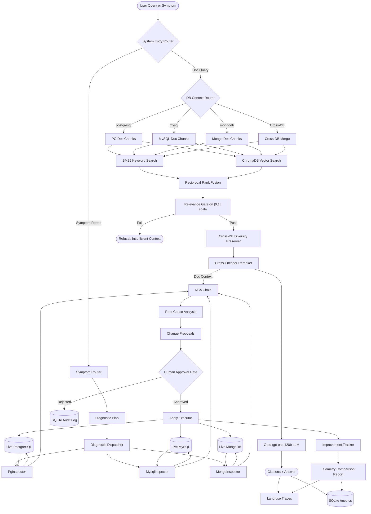

# DBrain performance RAG and diagnostic co-pilot

A hybrid retrieval-augmented generation (RAG) system with live database diagnostics and automated quality gating. It provides SQL and NoSQL performance tuning guidance based on official documentation for PostgreSQL, MySQL, and MongoDB.

This project is the chat interface, RAG, and query-remediation module for DBrain, an AI database performance optimizer. It functions as a complete diagnostics loop: routing complaints, inspecting live databases, running root-cause analysis, and validating performance gains empirically.

---

#### DBrain interface

Here is the multi-turn chat and remediation dashboard:


## System architecture

Here is the dual-path execution flow. The first path provides standard documentation Q&A, and the second path performs active diagnostics, remediation, and performance verification against live databases.



## Why this project is different

Most RAG systems are simple wrapper APIs search-ranking text documents. This project implements a closed-loop diagnostic and healing pipeline that operates on live database systems, using documentation to guide concrete fixes.

### 1. Active diagnostics via live database connection

Instead of relying solely on the user's report, the co-pilot creates read-only inspection connections to PostgreSQL, MySQL, and MongoDB. It extracts live operational telemetry:

- **PostgreSQL**: sequential scan counts, index scan ratios, autovacuum locks, forced checkpoint warnings, and cache hit ratios.
- **MySQL**: InnoDB buffer pool utilization, open transaction locks, and slow query lists.
- **MongoDB**: WiredTiger cache eviction pressure, active operations, and index usage.

### 2. Context-telemetry fusion (root cause analysis)

The Root Cause Analysis (RCA) chain receives live metrics from the database inspectors and matches them with vector chunks retrieved from official documentation. An LLM parses the combined context to identify the performance bottleneck, outputs ranked findings, and suggests a non-destructive `ChangeProposal` for each finding.

### 3. Scale-safe hybrid retrieval and evidence gates

To avoid the inconsistency of mixing cosine distance ranges with unbounded BM25 scores, the retrieval pipeline combines sparse and dense scoring via Reciprocal Rank Fusion (RRF) and normalizes the results to a `[0,1]` scale. If no document score exceeds the relevance threshold (0.15), the system declines to answer rather than fabricating a response.

### 4. Cross-database diversity preservation

When a query touches multiple databases, our entry router flags the input as ambiguous. Rather than allowing one database to dominate the search results, the query engine retrieves candidate documents from all three database engines separately, merging them under a strict representation guarantee.

### 5. Safe execution with human-in-the-loop controls

Execution of database commands follows the human-in-the-loop pattern. Proposals go through a state machine managed by SQLite: `pending`, `approved`, `applied`, or `rejected`. The change manager runs lexical checks to block destructive queries (such as `DROP`, `DELETE`, or `TRUNCATE`) and manages runtime differences, like running PostgreSQL index builds concurrently outside transaction blocks.

### 6. Closed-loop verification

After code execution, the improvement tracker takes another metric snapshot, waits for query plans to settle, and compares the logs before and after the change. This provides a direct confirmation of performance improvements, such as calculating index scan speed improvements or lock contention reductions.

### 7. Core observability and quality gates

We trace each stage of retrieval, reranking, and generation with Langfuse. The integration test suite uses a golden evaluation dataset verified by RAGAS, establishing minimum performance requirements (`faithfulness >= 0.75` and `answer_relevancy >= 0.70`) before changes compile.

## Tech stack and key concepts

| Component              | Technology                             | Role                                                                           |
| ---------------------- | -------------------------------------- | ------------------------------------------------------------------------------ |
| **Frontend**           | React, TypeScript, react-markdown      | Chat dashboard, session history, and action execution UI                       |
| **Backend**            | Python, FastAPI, uvicorn               | Core server exposing `/api/v1/query`, `/sessions`, `/metrics`, and `/diagnose` |
| **Vector store**       | ChromaDB (persistent local)            | Dense search over 1,193 document chunks                                        |
| **Embeddings**         | `all-MiniLM-L6-v2` ONNX                | Local, offline embeddings running without an API key                           |
| **Sparse search**      | Rank-BM25                              | Keyword lookup for technical variables like `pg_stat_statements`               |
| **Reranker**           | Cross-encoder `ms-marco-MiniLM-L-6-v2` | Relevance score refinement, skips gracefully if not installed                  |
| **LLM provider**       | Groq / gpt-oss-120b                    | Generates documentation answers and parses diagnostic JSON                     |
| **Sessions & metrics** | SQLite                                 | Persistent chat history and P50/P95 latency tracking                           |
| **Observability**      | Langfuse SDK / OpenTelemetry           | Telemetry tracing across retrieval, rerank, and generation paths               |
| **Evaluation**         | RAGAS                                  | Automated CI testing to measure faithfulness and relevance                     |
| **CI/CD**              | GitHub Actions                         | Automated evaluation gating on pull requests                                   |
| **Deployment**         | Docker / render.yaml                   | Multi-stage Docker config                                                      |

## Module requirements traceability

| Requirement                       | Description                                        | Location in codebase                                |
| --------------------------------- | -------------------------------------------------- | --------------------------------------------------- |
| **FE-7.1** Chat history           | Multi-turn sessions using SQLite                   | `backend/chat.py` (sessions) and `App.tsx` (UI)     |
| **FE-7.2** Context providers      | Pluggable documentation retrieval helpers          | `backend/providers.py`                              |
| **FE-7.3** Cross-database queries | Multi-database routing and diversity filters       | `detect_database` (ties trigger multi-DB retrieval) |
| **FE-7.4** Command guardrail      | Lexical scanner to block dangerous statement types | `backend/guardrails.py`                             |
| **FE-7.5** Recommendation action  | Propose action flow with human approval controls   | `backend/change_manager.py`                         |

## Key behaviors

1. **Database routing**: `detect_database` counts keywords for each engine, filtering out overlapping strings. Single-engine queries target the specified documentation. Cross-database queries retrieve documents from all targets and apply a diversity filter to prevent starving any engine.
2. **Relevance gating**: candidate documents use RRF scores normalized to `[0,1]`. Items scoring below 0.15 are excluded. If no documents remain, the backend returns a default message indicating insufficient context, preventing hallucinating incorrect answers.
3. **Citations**: the system appends `[Source: doc_name (database)]` references after claims and outputs a summary source table at the end of the text.
4. **Command guardrails**: statement execution blocks queries containing destructive SQL or NoSQL actions (including `DROP`, `DELETE`, or `TRUNCATE`) while allowing educational questions.
5. **Session persistence**: SQLite preserves message logs and computes overall latency percentiles and refusal rates on `/metrics`.
6. **Graceful degradation**: OpenAI or Gemini LLMs serve as automatic backups if Groq times out. The system skips reranking if local dependencies are missing, and runs embeddings local and offline by default.

## Local setup and execution

### 1. Prerequisites

- Python 3.10 or higher
- Node.js 18 or higher
- A Groq API key: the primary LLM provider

### 2. Environment configuration

Copy the example environment file:

```powershell
Copy-Item .env.example .env
```

Edit `.env` to set your api keys. For diagnostic features, configure the database connection strings.

### 3. Install dependencies and index documentation

```powershell
# Create and activate virtual environment
python -m venv dbrain
dbrain\Scripts\activate

# Install requirements
pip install -r requirements.txt

# Run indexing script to build Chroma and BM25 local databases
python scripts/reindex.py
```

### 4. Run the applications

Start the FastAPI server:

```powershell
uvicorn backend.main:app --host 0.0.0.0 --port 8000
```

In a new terminal window, start the React application:

```powershell
cd frontend
npm install
npm start
```

### 5. Verify the API

```powershell
$body = @{ query = "How do I create a B-tree index in PostgreSQL?" } | ConvertTo-Json
Invoke-RestMethod -Uri http://127.0.0.1:8000/api/v1/query -Method Post -ContentType "application/json" -Body $body
```

## Testing and evaluation

Run unit and integrity tests:

```powershell
python -m pytest tests/ -q
```

Trigger the RAGAS evaluation runner:

```powershell
$env:EVAL_LIMIT="3"; python eval/run_eval.py
```

Our GitHub Actions pipeline (`.github/workflows/eval.yml`) verifies code compilation, runs the backend test suite, and gates integration builds on minimum RAGAS scores.

## Core configuration parameters (`backend/config.py`)

| Environment variable  | Default value         | Purpose                                                               |
| --------------------- | --------------------- | --------------------------------------------------------------------- |
| `EMBEDDING_PROVIDER`  | `local`               | Embedding engine choice: `local` (offline ONNX), `jina`, or `gemini`  |
| `GROQ_MODEL`          | `openai/gpt-oss-120b` | Model used for chat, diagnostics, and evaluations                     |
| `RELEVANCE_THRESHOLD` | `0.15`                | Minimum normalized reference score allowed through the relevance gate |
| `RERANKER_ENABLED`    | `true`                | Standard cross-encoder activation status                              |
| `PG_DIAG_DSN`         | None                  | Read-only connection string for PostgreSQL diagnostics                |
| `MYSQL_DIAG_DSN`      | None                  | Read-only connection string for MySQL diagnostics                     |
| `MONGO_DIAG_URI`      | None                  | Read-only connection string for MongoDB diagnostics                   |
| `PG_APPLY_DSN`        | None                  | Execution connection string for PostgreSQL change applications        |
| `MYSQL_APPLY_DSN`     | None                  | Execution connection string for MySQL change applications             |
| `MONGO_APPLY_URI`     | None                  | Execution connection string for MongoDB change applications           |

## Cleaning up unused files

The following directories represent earlier tests or manual steps and are not required by the active service:

- `chroma_db/` and `chroma_db_v2/` (legacy database storage paths, replaced by `./chroma_db_local`)
- `LangChain/` (early design scripts, replaced by production code under `backend/`)
