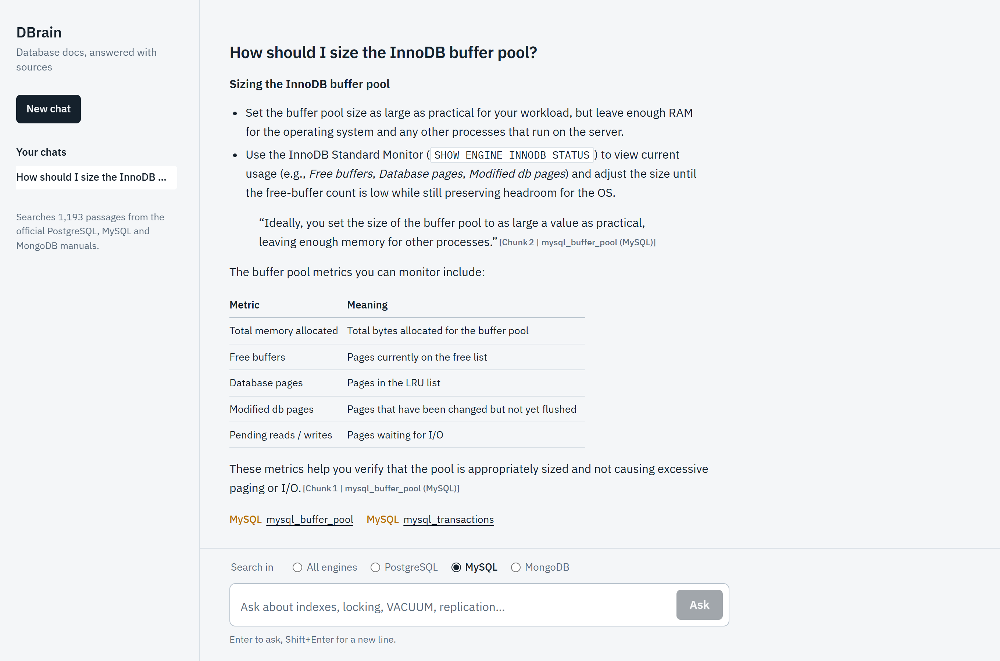

# DBrain Performance RAG — Technical Co-Pilot

A metrics-driven, CI-gated **Retrieval-Augmented Generation (RAG)** system that answers performance-optimization questions over the official **PostgreSQL**, **MySQL**, and **MongoDB** documentation with verifiable citations.

This is **Module 7 (Chat Interface & RAG)** of **DBrain**, an AI-powered database performance co-pilot. The design favors honest, production-grade behavior: local-by-default embeddings, a standardised hosted LLM, evidence gates that refuse rather than hallucinate, and full observability.



## System Architecture

```mermaid
graph TD
    User([User Query]) --> FE[React Frontend]
    FE -->|POST /api/v1/query| BE[FastAPI Backend]

    subgraph Pipeline [Retrieval Pipeline]
        BE --> Router{DB Router}
        Router -->|postgresql| PG[PG Chunks]
        Router -->|mysql| MY[MySQL Chunks]
        Router -->|mongodb| MO[Mongo Chunks]
        Router -->|None / cross-DB tie| ALL[Per-DB retrieval, then merge]

        PG & MY & MO & ALL --> BM25[BM25 Sparse]
        PG & MY & MO & ALL --> Chroma[ChromaDB Dense]

        BM25 --> RRF[Reciprocal Rank Fusion]
        Chroma --> RRF
        RRF --> Gate[Relevance Gate on [0,1] scale]
        Gate --> Div[Cross-DB Diversity]
        Div --> Rerank[Optional Cross-Encoder]
    end

    subgraph Gen [Grounded Generation]
        Rerank --> LLM[Groq gpt-oss-120b]
        LLM --> Answer[Answer + Citations]
        LLM -->|insufficient context| Refused[Refusal Message]
    end

    Answer --> LF[Langfuse Traces]
    Answer --> Metrics[(SQLite /metrics)]
    Answer --> FE
```

## Tech Stack

| Component | Technology | Role |
|---|---|---|
| **Frontend** | React, TypeScript, react-markdown | Dark dashboard: multi-turn chat, session persistence, "Propose Action" |
| **Backend** | Python, FastAPI, uvicorn | `/api/v1/query`, `/sessions`, `/metrics`, `/stats`, `/health` |
| **Vector store** | ChromaDB (persistent, local) | Dense semantic search over 1,193 chunks |
| **Embeddings** | `all-MiniLM-L6-v2` via ChromaDB ONNX (`EMBEDDING_PROVIDER=local`) | Offline, 384-dim, no API key |
| **Sparse search** | Rank-BM25 (per-database indexes) | Exact keyword match (e.g. `pg_stat_statements`) |
| **Fusion** | Reciprocal Rank Fusion (RRF) | Blends BM25 + dense rankings |
| **Reranker** | `cross-encoder/ms-marco-MiniLM-L-6-v2` (optional) | Deep relevance rescoring; graceful skip when not installed |
| **LLM** | Groq `openai/gpt-oss-120b` | Chat + RAGAS evaluator (Ollama/Gemini demoted to optional fallbacks) |
| **Sessions** | SQLite (`backend/chat.py`) | Multi-turn history, `session_id` on `/query` |
| **Metrics** | SQLite (`backend/metrics_store.py`) | P50/P95 latency, refusal rate, per-DB breakdown |
| **Observability** | Langfuse SDK / OpenTelemetry | Span attributes: detected_db, chunks, scores, per-stage latency |
| **Evaluation** | RAGAS | Faithfulness / Answer Relevancy gate in CI |
| **CI/CD** | GitHub Actions | Unit + API tests always; RAGAS gate with `EVAL_LIMIT=3` |
| **Deploy** | Docker / docker-compose / render.yaml | Multi-stage Dockerfile, frontend served via nginx-less static build |

## Module 7 Requirements Traceability

| Requirement | Where it lives |
|---|---|
| **FE-7.1** Chat with history | `backend/chat.py` SQLite sessions; `App.tsx` multi-turn UI, localStorage persistence, "New Chat Session" |
| **FE-7.2** Context providers | `backend/providers.py` — pluggable `ContextProvider` interface, docs-only default, graceful degradation |
| **FE-7.3** Cross-database queries | Ambiguous routing in `detect_database` (ties → `None`), per-DB retrieval + `ensure_db_diversity` |
| **FE-7.4** Command guardrail | `backend/guardrails.py::check_command_guardrail` — blocks destructive statements, allows learning questions |
| **FE-7.5** Recommendation action | `POST /api/v1/actions` (pending-recommendation stub) + "Propose Action" button in the UI |

## Key Behaviors

1. **Honest routing** — `detect_database` scores keyword concepts (deduplicated for substring overlap). Single-DB questions scope retrieval to that engine; cross-DB questions (ties) retrieve every engine's best chunks so no database is starved out.
2. **Evidence gate, not guesswork** — retrieved chunks are scored on a normalised `[0,1]` scale; below `RELEVANCE_THRESHOLD` (0.15) they are dropped. If nothing survives, the system refuses: *"I cannot answer this question based on the available documentation."* — no hallucination.
3. **Exact citations** — the prompt requires `[Source: doc_name (Database)]` after every claim plus a `Sources:` section; sources are echoed from the actually-used chunks.
4. **Command guardrail** — `DROP/DELETE/TRUNCATE/UPDATE/INSERT/ALTER…DROP` prompts are refused with a guardrail reason; "how do I drop…" learning questions still get documented guidance.
5. **Multi-turn sessions** — history is injected into the prompt; `/metrics` records latency percentiles and refusal rate.
6. **Provider resilience** — LLM calls retry with exponential backoff on 503/429/queue-full; reranker and Langfuse degrade gracefully; embeddings run fully offline by default.

## Local Setup

### 1. Prerequisites
- Python 3.10+
- Node.js 18+
- A Groq API key (`GROQ_API_KEY`) — the only required external credential

### 2. Environment
```powershell
Copy-Item .env.example .env
# edit .env: set GROQ_API_KEY
```

### 3. Ingest + index
```powershell
python -m venv dbrain
dbrain\Scripts\activate
pip install -r requirements.txt
python scripts/reindex.py          # builds Chroma + BM25 indexes (local embeddings)
```

### 4. Run
```powershell
uvicorn backend.main:app --host 0.0.0.0 --port 8000
# second terminal:
cd frontend
npm install
npm start
```

### 5. Smoke test
```powershell
$body = @{ query = "What types of indexes does PostgreSQL support?" } | ConvertTo-Json
Invoke-RestMethod -Uri http://127.0.0.1:8000/api/v1/query -Method Post -ContentType "application/json" -Body $body
```

## Tests & Evaluation

```powershell
python -m pytest tests/ -q          # 31 unit + API tests (hermetic, offline)
$env:EVAL_LIMIT="3"; python eval/run_eval.py   # RAGAS gate, Groq evaluator + local embeddings
```

CI (`.github/workflows/eval.yml`) always runs the unit/API suite, verifies the service boots via the render start command, and gates merges on RAGAS scores.

## Configuration Highlights (`backend/config.py`)

| Env var | Default | Meaning |
|---|---|---|
| `EMBEDDING_PROVIDER` | `local` | `local` (offline ONNX) / `jina` / `gemini` |
| `GROQ_MODEL` | `openai/gpt-oss-120b` | Chat + evaluator LLM |
| `CORS_ORIGINS` | `http://localhost:3000` | Comma-separated allowlist |
| `API_KEY` | *(empty)* | Optional bearer auth; empty disables |
| `RELEVANCE_THRESHOLD` | `0.15` | Evidence gate on normalised score |
| `RERANKER_ENABLED` | `true` | Cross-encoder; auto-skips if package missing |
| `DB_FILE` / `CHROMA_PERSIST_DIR` / `DOCS_DIR` | defaults | SQLite / vector store / corpus paths |

## Housekeeping: Redundant Files

The following are **not** part of the current pipeline and can be removed to save space:
- `chroma_db/`, `chroma_db_v2/` — older vector stores (active: `./chroma_db_local`)
- `LangChain/` — experimental tutorial scripts; production RAG lives in `backend/`
