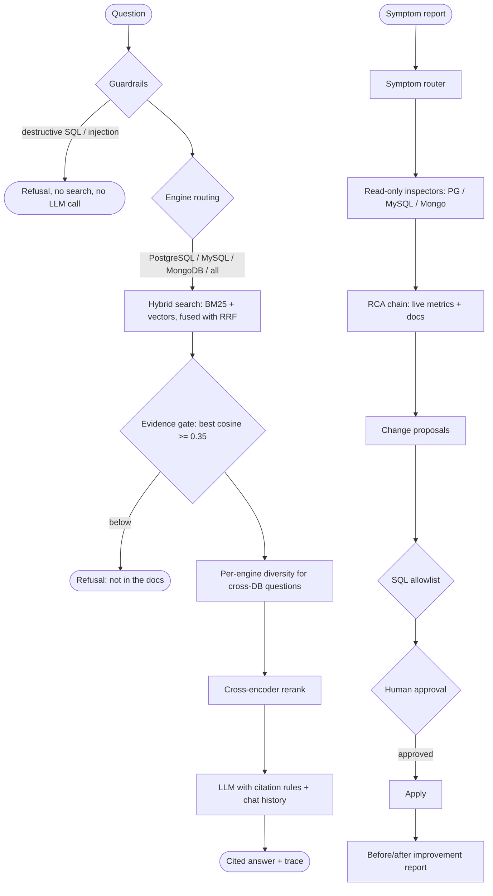

# DBrain: database docs co-pilot

Ask the PostgreSQL, MySQL and MongoDB manuals a question and get an answer that cites its sources. When the docs don't cover a question, DBrain refuses instead of guessing. A second path, the diagnostic agent, inspects live databases, finds root causes and proposes safe fixes that a human approves before anything runs.


Every answer comes with an `EXPLAIN ANALYZE`-style trace showing how it was built: which engine it was routed to, what the hybrid search returned, what the reranker kept, and how long each stage took.

## Architecture



### Design decisions

| Decision | Why |
| --- | --- |
| **Absolute evidence gate** on the best dense cosine similarity | Min-max-normalised RRF always scores the top chunk 1.0, so a relative threshold never refuses anything. On the golden set, on-topic questions score at least 0.56 and off-topic ones at most 0.23, so the gate sits at 0.35. |
| **Guardrails run before retrieval** | Blocked prompts cost nothing: no embedding, search or LLM call. |
| **SQL allowlist** for applying changes (not a blocklist) | LLM-written SQL runs with schema-owner rights. Only single statements such as `CREATE INDEX`, `ANALYZE`, `VACUUM` and `ALTER TABLE … SET (…)` pass; chained statements, comments, `COPY … PROGRAM`, `ALTER SYSTEM` and writes are rejected, and the check runs again at execution time. |
| **Open Q&A, admin-key operator endpoints, per-IP rate limit** | Anyone can try the demo. Approve/apply, diagnose and listings need `API_KEY`, and the rate limit protects the LLM key. |
| **Index built from the versioned corpus**, never committed | The Docker image bakes it in at build time; local runs build it on first boot. No binary index churn in git. |
| **One origin** | FastAPI serves the built React app, so there's no CORS setup or second deployment. |
| **Sync handlers for blocking work** | DB drivers, LLM calls and the post-apply wait run in FastAPI's threadpool, not on the event loop. |

## Stack

| Layer | Choice |
| --- | --- |
| API | FastAPI, Python 3.11 |
| Retrieval | ChromaDB with local `all-MiniLM-L6-v2` ONNX embeddings (offline, no key), `rank-bm25`, RRF |
| Reranker | `cross-encoder/ms-marco-MiniLM-L-6-v2` (lazy-loaded; disable on small instances) |
| LLM | Groq `openai/gpt-oss-120b`, falling back to Gemini or Ollama |
| State | SQLite: chat sessions, request metrics, change proposals, audit log |
| UI | React + TypeScript, IBM Plex, light and dark themes |
| Observability | Langfuse tracing (enabled when keys are set) |
| Quality | pytest suite + RAGAS gate in CI |

## Run it

### Docker (recommended)

```bash
cp .env.example .env        # set GROQ_API_KEY
docker compose up --build   # http://localhost:8000
```

### Local development

Requires Python 3.11 and Node 24 (matches the lockfile). [uv](https://docs.astral.sh/uv/) is the fastest way to get the environment:

```powershell
uv venv .venv --python 3.11
uv pip install --python .venv\Scripts\python.exe -r requirements-dev.txt
Copy-Item .env.example .env   # set GROQ_API_KEY

# API on :8000 (builds the index on first start, about 1 minute)
.venv\Scripts\python.exe -m uvicorn backend.main:app --reload

# UI on :3000 with hot reload (in a second terminal)
cd frontend; npm install; npm start
```

Running `npm run build` in `frontend/` makes the API serve the UI itself at `http://localhost:8000`.

## Deploy

**Render (free)**: create a Blueprint from this repo. `render.yaml` defines one Docker web service. Set `GROQ_API_KEY` in the dashboard. The free plan has 512 MB of RAM, so the blueprint disables the reranker; set `RERANKER_ENABLED=true` on a 2 GB+ instance. Chat history lives in SQLite inside the container and resets on redeploy. If your existing Render service was created with the old Python runtime, recreate it from the Blueprint.

**Hugging Face Spaces / Fly.io / any Docker host**: the image listens on `$PORT` and needs only `GROQ_API_KEY`. Spaces' free CPU tier (16 GB) runs it with the reranker on.

## API

| Endpoint | Access | Purpose |
| --- | --- | --- |
| `POST /api/v1/query` | public, rate-limited | Cited answer + citations, timings, refusal flags |
| `POST /api/v1/sessions`, `GET /api/v1/sessions/{id}/messages` | public (the id is the secret) | Multi-turn chat history |
| `POST /api/v1/actions` | public | Send an answer for approval (FE-7.5) |
| `GET /api/v1/status`, `/metrics`, `/health` | public | Index size, models, P50/P95 latency, refusal rate |
| `POST /api/v1/diagnose` | admin | Symptom → live inspection → RCA → proposals |
| `POST /api/v1/proposals/{id}/approve \| reject \| apply` | admin | Human-in-the-loop change workflow |
| `GET /api/v1/proposals/{id}/improvement` | admin | Before/after metric comparison |
| `GET /api/v1/sessions`, `/api/v1/actions`, `/api/v1/proposals` | admin | Operator listings |

Admin endpoints take `X-API-Key: <API_KEY>` or `Authorization: Bearer <API_KEY>`. With `API_KEY` unset (local dev) they are open. Interactive docs are at `/docs`.

## Configuration

| Variable | Default | Purpose |
| --- | --- | --- |
| `GROQ_API_KEY` | none | Primary LLM provider (required) |
| `GROQ_MODEL` | `openai/gpt-oss-120b` | Chat, RCA and evaluation model |
| `API_KEY` | empty | Admin key for operator endpoints |
| `RATE_LIMIT_PER_MINUTE` | `20` | Per-IP budget for `/query` and `/diagnose` (`0` disables) |
| `MIN_SEMANTIC_SIMILARITY` | `0.35` | Absolute evidence gate |
| `RELEVANCE_THRESHOLD` | `0.15` | Relative cut-off applied after the gate |
| `RERANKER_ENABLED` | `true` | Cross-encoder rerank (loads torch) |
| `EMBEDDING_PROVIDER` | `local` | `local` (offline ONNX), `jina` or `gemini`; switching requires `python scripts/reindex.py` |
| `CORS_ORIGINS` | `http://localhost:3000` | Only needed when the UI is served from another origin |
| `DB_FILE` | `./data/dbrain.db` | SQLite file for sessions, metrics and proposals |
| `PG_DIAG_DSN`, `MYSQL_DIAG_DSN`, `MONGO_DIAG_URI` | none | Read-only connections for diagnostics |
| `PG_APPLY_DSN`, `MYSQL_APPLY_DSN`, `MONGO_APPLY_URI` | none | Connections used only after approval |
| `LANGFUSE_PUBLIC_KEY`, `LANGFUSE_SECRET_KEY` | none | Enable tracing |

## Tests and evaluation

```powershell
.venv\Scripts\python.exe -m pytest tests -q          # hermetic: no network, keys or index
$env:EVAL_LIMIT="3"; .venv\Scripts\python.exe eval/run_eval.py   # RAGAS gate
```

CI (`.github/workflows/eval.yml`) runs the tests, builds the UI, builds and boots the production image, and on pushes to `main` runs the RAGAS gate (`faithfulness >= 0.75`, `answer_relevancy >= 0.70`).

## Requirements traceability

| Requirement | Where |
| --- | --- |
| FE-7.1 Chat history | `backend/chat.py`, sidebar chats in `frontend/src/App.tsx` |
| FE-7.2 Context providers | `backend/providers.py` |
| FE-7.3 Cross-database queries | `detect_database` + per-engine retrieval in `backend/rag_chain.py` |
| FE-7.4 Command guardrail | `backend/guardrails.py` |
| FE-7.5 Recommendation action | "Send for approval" → `POST /api/v1/actions`; diagnostics in `backend/change_manager.py` |
